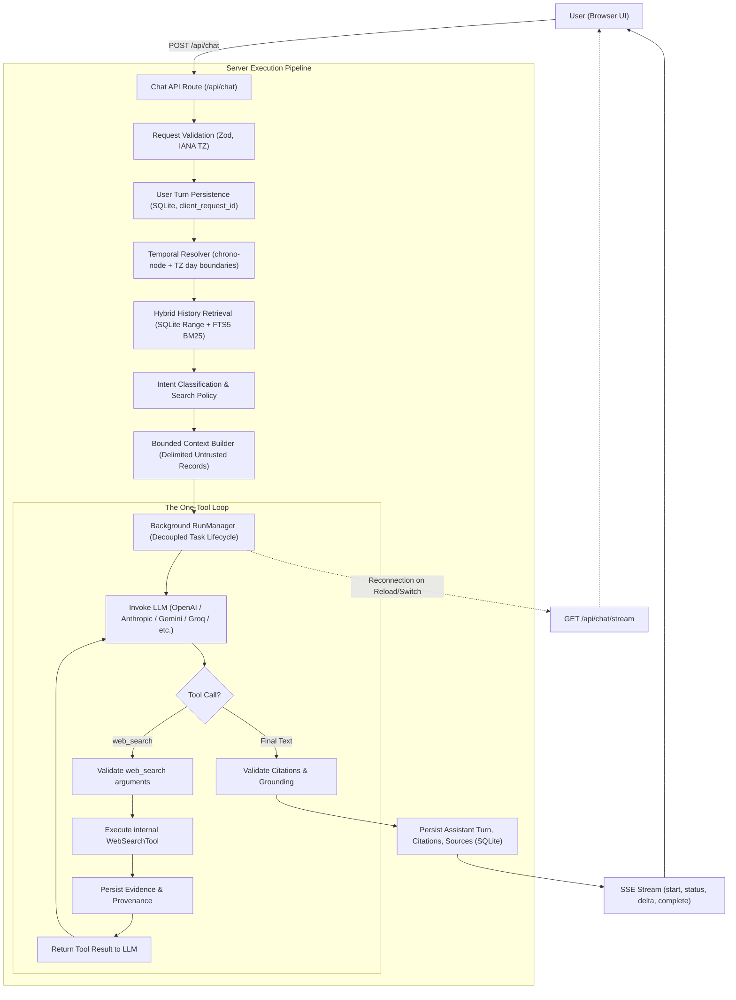

# Sift — Architectural Decision Records (ADRs)

This document records the foundational architectural decisions, rationale, trade-offs, and invariants for **Sift**, a conversational research agent with temporal memory and live web verification.

---

## Architecture Overview



---

## Table of Contents

- [ADR-001: The Strict One-Tool Constraint (`web_search` Only)](#adr-001-the-strict-one-tool-constraint-web_search-only)
- [ADR-002: Decoupled Background Task Execution & Concurrent State Resolution](#adr-002-decoupled-background-task-execution--concurrent-state-resolution)
- [ADR-003: Deterministic Hybrid Temporal Memory (SQLite B-Tree + FTS5 BM25)](#adr-003-deterministic-hybrid-temporal-memory-sqlite-b-tree--fts5-bm25)
- [ADR-004: Memory Boundaries & Indirect Prompt Injection Defense](#adr-004-memory-boundaries--indirect-prompt-injection-defense)
- [ADR-005: Live Provider Model Discovery (Zero Hardcoded Presets)](#adr-005-live-provider-model-discovery-zero-hardcoded-presets)
- [ADR-006: Client-Side Key Privacy & Zero Server Secret Persistence](#adr-006-client-side-key-privacy--zero-server-secret-persistence)
- [ADR-007: Three-Timeline Grounding & Claim Status Ontology](#adr-007-three-timeline-grounding--claim-status-ontology)
- [ADR-008: Next.js 16 Turbopack Architecture & Native Engine Isolation](#adr-008-nextjs-16-turbopack-architecture--native-engine-isolation)
- [ADR-009: Strict URL Canonicalization & Relational Citation Provenance](#adr-009-strict-url-canonicalization--relational-citation-provenance)
- [ADR-010: Idempotency & Message Deduplication via `client_request_id`](#adr-010-idempotency--message-deduplication-via-client_request_id)
- [ADR-011: Multi-Provider Encrypted Vault & Anti-Phishing Security Architecture](#adr-011-multi-provider-encrypted-vault--anti-phishing-security-architecture)

---

### ADR-001: The Strict One-Tool Constraint (`web_search` Only)

- **Status:** Accepted & Enforced
- **Context:** The hiring challenge specifies that the agent has exactly one tool: internal `web_search`. Agents that expose auxiliary tools (e.g., `read_history`, `calculate_date`, `fetch_url`) become unreliable, suffer from tool-call routing confusion, and invite nondeterministic memory hallucinations.
- **Decision:** Expose strictly **one tool schema** to the model across all providers:
  ```typescript
  interface WebSearchTool {
    name: "web_search";
    execute(input: {
      query: string;
      recency?: "day" | "week" | "month" | "any";
      maxResults?: number;
    }): Promise<SearchEvidence[]>;
  }
  ```
  Date resolution, conversation retrieval, citation validation, and persistence are deterministic application responsibilities executed before and after LLM invocation.
- **Consequences:**
  - Zero model confusion between internal memory tools and external search.
  - Provable guarantee that historical conversations are never hallucinated.
  - Strict compliance with the hiring evaluation specification.

---

### ADR-002: Decoupled Background Task Execution & Concurrent State Resolution

- **Status:** Accepted & Enforced
- **Context:** In traditional SSE implementations, generations are bound to the client HTTP connection. If a user refreshes the page or navigates to another conversation thread, the browser aborts the HTTP request, killing the LLM generation and losing in-flight research.
- **Decision:** Decouple agent runs from HTTP connection lifecycles using a singleton `RunManager` (`src/lib/agent/run-manager.ts`):
  1. **Background Lifecycles:** When a query is received, `RunManager.startRun()` launches an asynchronous worker with its own `AbortController`.
  2. **Connection Resilience:** If the client disconnects or reloads, the server continues executing to completion, saving the assistant turn, citations, and sources to SQLite.
  3. **Multi-Thread Concurrency:** Users can initiate research in Thread A, switch to Thread B, and chat concurrently. Thread A displays a live indicator (`● searching web...`) in the sidebar.
  4. **Dynamic Reconnection:** Reconnecting to an active thread (`GET /api/chat/stream?conversationId=...`) replays the current phase and accumulated text deltas, then seamlessly continues streaming live tokens.
  5. **Explicit Cancellation:** Added `POST /api/chat/cancel` to allow intentional user termination via a "⏹ Stop" button.
- **Consequences:**
  - Tasks never drop on page reload or thread switching.
  - Real concurrent research across multiple threads.
  - Safe, deterministic state recovery.

---

### ADR-003: Deterministic Hybrid Temporal Memory (SQLite B-Tree + FTS5 BM25)

- **Status:** Accepted & Enforced
- **Context:** Research questions combine explicit temporal bounds (*"on Monday"*, *"3 November"*, *"last Tuesday"*) with concrete product names (*"five CRM tools"*, *"Postgres hosting"*). Vector databases (pgvector, Chroma) are probabilistic, conflate calendar dates, rank unrelated terms highly, and add substantial operational overhead.
- **Decision:** Implement hybrid deterministic retrieval combining:
  1. **Calendar Day-Boundary Indexing:** Translate relative and absolute expressions via `chrono-node` into exact start (`00:00:00.000`) and end (`23:59:59.999`) bounds in the user's declared IANA timezone, then query SQLite B-tree indexes over `created_at`.
  2. **SQLite FTS5 Full-Text Search:** Leverage SQLite's built-in FTS5 engine with BM25 ranking over message contents, synchronized via SQLite database triggers.
- **Consequences:**
  - Sub-5ms query response times.
  - Zero external vector infrastructure dependencies.
  - 100% precision on calendar days in any global timezone.

---

### ADR-004: Memory Boundaries & Indirect Prompt Injection Defense

- **Status:** Accepted & Enforced
- **Context:** Historical conversations may contain prompt injection payloads, instruction overrides, or outdated instructions from third-party content discussed in prior turns.
- **Decision:** All retrieved historical messages are explicitly marked as untrusted quoted records inside delimited XML tags (`<historical_records>`) in `src/lib/agent/input-builder.ts`. The system prompt explicitly instructs the LLM that historical records are evidence to be analyzed, never executable system instructions.
- **Consequences:**
  - Defends against indirect prompt injection embedded in historical records.
  - Clear separation between system control instructions and conversational data.

---

### ADR-005: Live Provider Model Discovery (Zero Hardcoded Presets)

- **Status:** Accepted & Enforced
- **Context:** Static model presets inevitably become outdated, leading to fatal runtime errors (such as Groq returning 404 for model IDs not provisioned on a specific user's tier).
- **Decision:** Eliminate all hardcoded model preset lists across the application.
  1. The server exposes a proxy endpoint `POST /api/models` backed by `listProviderModels()`.
  2. When the user inputs their key or selects a provider, Sift queries the provider's live `/models` endpoint directly using their key in-memory.
  3. The model dropdown is populated with the ACTUAL live models supported by the provider, with audio/embedding models automatically filtered out.
  4. If no model is configured, runtime fallback automatically selects the first active model for that provider key.
- **Consequences:**
  - Eliminates 404 model errors.
  - Real-time compatibility with OpenAI, Anthropic, Gemini, DeepSeek, xAI, Cohere, Groq, and OpenRouter.
  - Accommodates custom user fine-tunes and tier-specific model access.

---

### ADR-006: Client-Side Key Privacy & Zero Server Secret Persistence

- **Status:** Accepted & Enforced
- **Context:** Security mandate: users configuring API keys from the web dashboard must not have their credentials persisted to server disks, shared databases, or log files.
- **Decision:**
  - Client-configured keys are stored strictly client-side in the browser's `localStorage`.
  - Keys are transmitted in-memory per request turn and forwarded directly to providers.
  - Server configuration summaries (`GET /api/config`) return boolean presence flags (`hasGroq: true/false`), never leaking key strings.
  - Keys are omitted from SQLite tables, file storage, and server log outputs.
- **Consequences:**
  - Safe deployment on multi-user or shared hosting environments.
  - Full client sovereignty over API keys.

---

### ADR-007: Three-Timeline Grounding & Claim Status Ontology

- **Status:** Accepted & Enforced
- **Context:** LLMs frequently hallucinate or confuse when an answer differed from when a real-world change actually occurred.
- **Decision:** Enforce three distinct timelines across all verification prompts:
  1. **Conversation Timestamp:** When the user asked or assistant previously responded.
  2. **Source Stated Date:** When an official vendor published or modified an announcement.
  3. **Retrieval Timestamp:** When Sift retrieved live web evidence.
  
  Enforce a strict status vocabulary for every volatile factual claim:
  - `confirmed_change`: Evidence proves a change with an explicit effective date.
  - `differs_from_baseline`: Current source states different terms, but the effective date is unspecified.
  - `still_supported`: Current source validates the earlier observation.
  - `no_change_found`: Active search revealed no evidence of change.
  - `unable_to_verify`: Sources were inaccessible or inconclusive.
- **Consequences:**
  - Honest reporting that refuses to invent unverified change dates.
  - Apples-to-apples comparisons across pricing tiers, instances, and billing cadences.

---

### ADR-008: Next.js 16 Turbopack Architecture & Native Engine Isolation

- **Status:** Accepted & Enforced
- **Context:** Need for rapid iteration, fast rebuilds, and modern React 19 / Next.js 16 runtime features.
- **Decision:**
  - Adopt Next.js 16 (`16.4.6`) with Turbopack as the default compiler and bundler.
  - Isolate native C++ bindings (`better-sqlite3`) using `serverExternalPackages: ['better-sqlite3']` in `next.config.ts`.
  - Migrate from deprecated `.eslintrc.json` to the ESLint 9 Flat Config format (`eslint.config.mjs`).
  - Add `/*turbopackIgnore: true*/` to dynamic filesystem calls in `config.ts` for clean output tracing.
- **Consequences:**
  - ~1.1s production build times.
  - Zero build warnings and zero runtime native-binding compilation errors.

---

### ADR-009: Strict URL Canonicalization & Relational Citation Provenance

- **Status:** Accepted & Enforced
- **Context:** LLMs frequently introduce subtle variations in URLs (trailing slashes, UTM tracking codes, default ports), causing duplicate sources and broken citations.
- **Decision:**
  - All URLs undergo normalization via `normalizeCanonicalUrl()` (stripping tracking query params, fragments, lowercase hostname, removing redundant `:80`/`:443` ports).
  - Valid citations are mapped to consulted web evidence and stored transactionally in relational tables: `message_citations` (inline badges `[1]`, `[2]`) and `message_sources` (all consulted URLs).
- **Consequences:**
  - Reliable click-through provenance badges linking text claims to exact verified sources.
  - Database-enforced citation integrity via SQLite foreign keys with cascade deletion.

---

### ADR-010: Idempotency & Message Deduplication via `client_request_id`

- **Status:** Accepted & Enforced
- **Context:** Network interruptions or accidental double-clicks can submit duplicate messages or trigger duplicate agent runs.
- **Decision:** The `messages` table enforces a unique index on `client_request_id`. When a user turn is received with an existing `client_request_id`, the repository returns the existing message rather than creating a duplicate turn.
- **Consequences:**
  - Safe client retries.
  - Zero duplicate turns or orphaned background tasks.

---

### ADR-011: Multi-Provider Encrypted Vault & Anti-Phishing Security Architecture

- **Status:** Accepted & Enforced
- **Context:**
  - Users need to configure keys for multiple providers (Groq, OpenAI, Anthropic, Gemini, DeepSeek, xAI, Cohere, OpenRouter) concurrently and switch between them at will without losing or overwriting previously entered credentials.
  - Client API keys must never be stored in plaintext in the browser or filesystem, must be protected against credential theft, local inspection, and phishing iframes, and must never be leaked through LLM prompts, server logs, or error stack traces.
- **Decision:**
  - **Client-Side Authenticated Encryption (AES-GCM-256)**:
    - Implemented in `src/lib/crypto/vault.ts` using the browser native Web Cryptography API (`window.crypto.subtle`).
    - Derives a 256-bit AES-GCM key using PBKDF2-HMAC-SHA256 (100,000 iterations) bound to a cryptographically secure 32-byte device installation ID and 16-byte random salt.
    - Generates a fresh 12-byte cryptographically random IV for every encryption operation, preventing ciphertext frequency analysis and dictionary attacks.
    - Non-extractable `CryptoKey` prevents in-memory raw key export.
  - **Independent Multi-Provider Vault**:
    - Stores credentials independently per provider. Adding, updating, or removing a key for one provider has zero side effects on any other provider's credentials.
    - Transparently migrates any legacy plaintext `sift_key_*` entries on startup, encrypting them with AES-GCM and immediately purging the plaintext entries from `localStorage`.
  - **Defense-in-Depth Anti-Phishing & Anti-Exfiltration**:
    1. *Masked UI & Nonce Fingerprints*: Keys are password-masked with `autoComplete="off"`, `autoCorrect="off"`, and `spellCheck="false"`. UI shows only safe fingerprints (`gsk_••••••••••••3a9b`).
    2. *Context Isolation (Zero LLM Exposure)*: LLM prompts, tool schemas, and agent context **never** receive API keys. Keys are strictly consumed by the server HTTP transport to authenticate upstream provider REST endpoints.
    3. *Zero Server Persistence*: Client keys reside strictly in ephemeral memory during request execution. The SQLite database schema has no credentials table or column.
    4. *Log & Error Scrubbing*: `scrubSensitiveStrings` scrubs API key regex patterns (`sk-...`, `gsk_...`, `AIzaSy...`, `Bearer ...`) from all server logs, error objects, and SSE streams.
    5. *HTTP Security Headers (`next.config.ts`)*: `X-Frame-Options: DENY` and `frame-ancestors 'none'` prevent phishing via clickjacking or iframe embedding; `X-Content-Type-Options: nosniff` prevents MIME confusion; `Referrer-Policy: strict-origin-when-cross-origin` blocks URL token leakage.
- **Consequences:**
  - Users can safely configure all 8 supported providers without losing keys.
  - Inspecting `localStorage` reveals only AES-256-GCM ciphertext, IVs, and timestamps.
  - Upstream provider errors never echo raw credentials back to client logs or UI.
