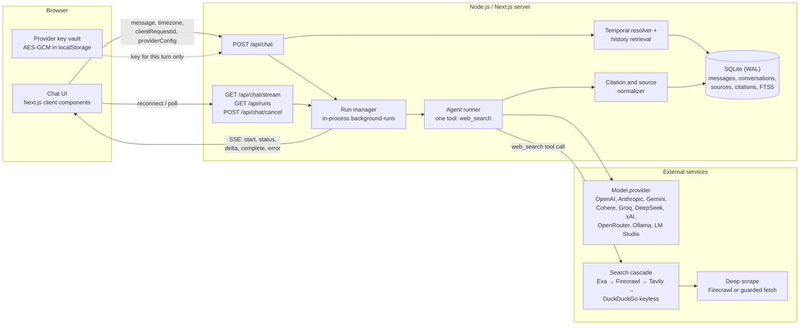
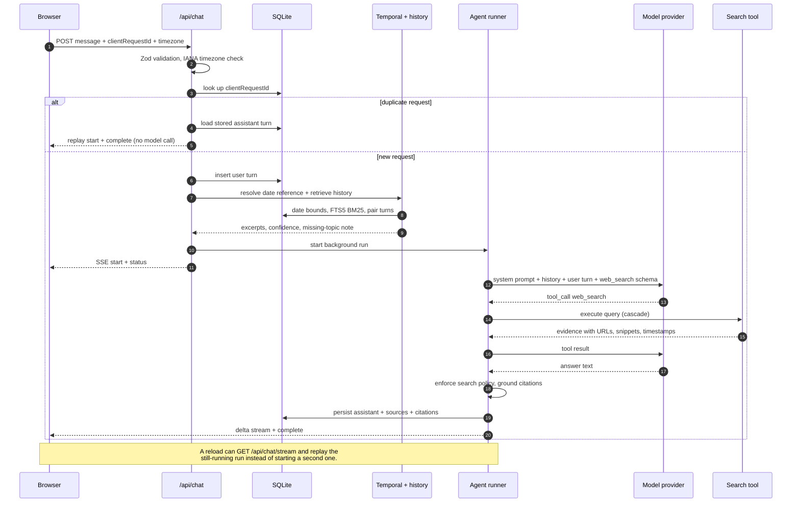
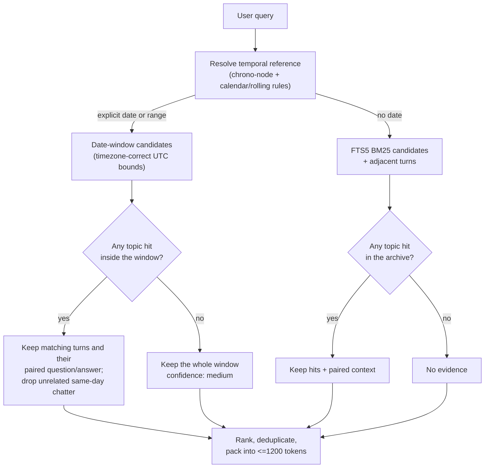
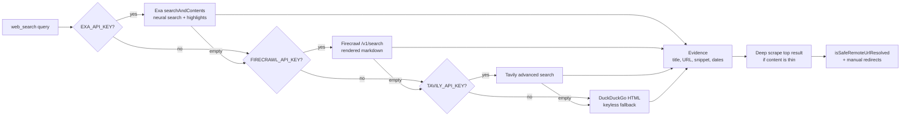
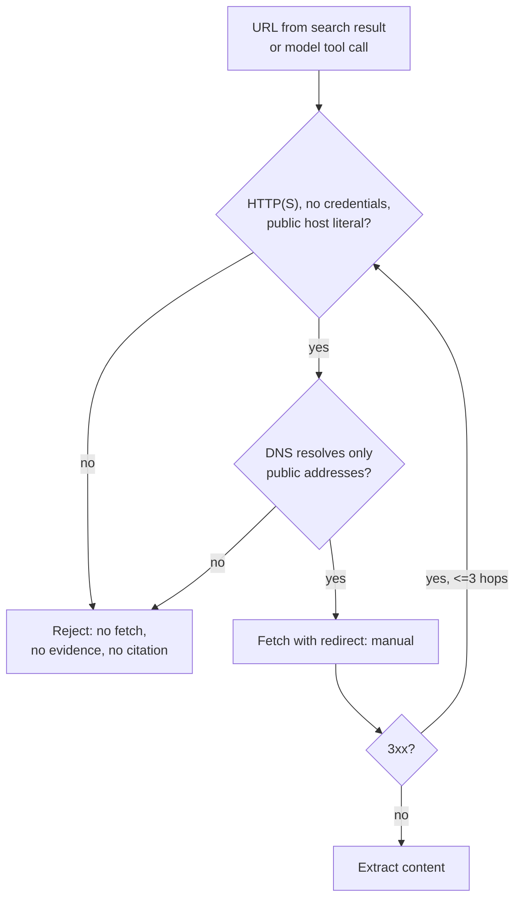
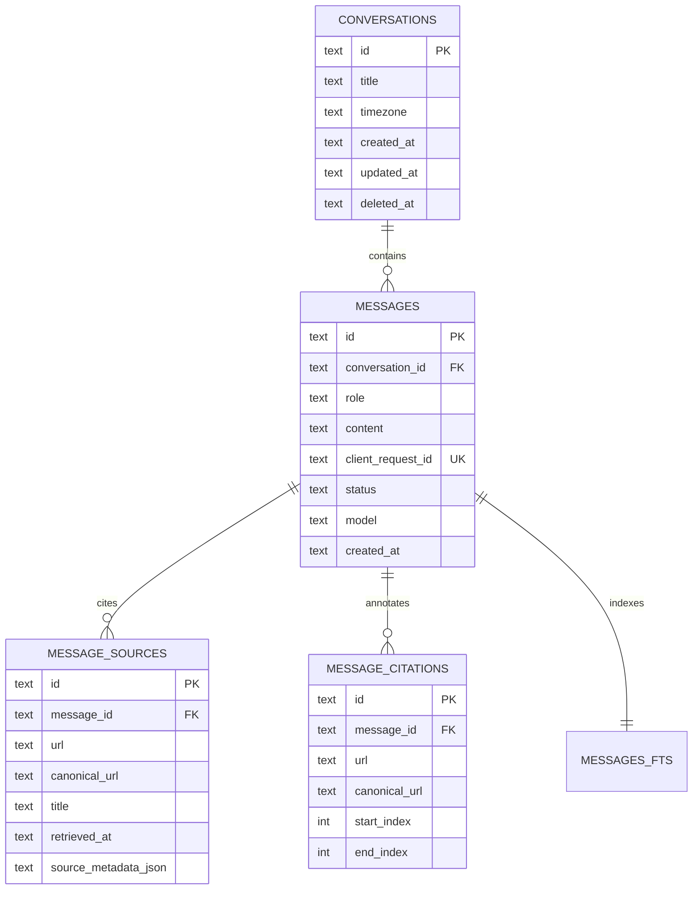

# Sift — Architecture

Sift is a Next.js chat agent with a deliberately small model surface: the model
gets exactly one tool, `web_search`. Everything that has to be exact — calendar
math, history lookup, search enforcement, citation grounding, persistence — is
deterministic server code.

## 1. System context

Keys entered in the browser are encrypted at rest and sent only inside the
request that needs them. Server-side `.env` keys are never combined with a
client-supplied base URL.

## 2. Request lifecycle

Search enforcement is part of the runner, not just the prompt:

- If the turn is volatile and no `web_search` call happened, the first answer is
  buffered, the model gets one corrective turn, and a second refusal returns an
  explicit verification failure.
- A search that returns no evidence appends a visible caveat instead of letting
  an unverified answer look sourced.

## 3. History retrieval

A resolved date is the primary constraint. Topic terms rank evidence inside that
window; they do not get to veto it.

Why the floor is window-scoped: users paraphrase. A Tuesday conversation may
only say “Neon and Supabase”, so “Postgres hosting” must not delete Tuesday just
because the word `Postgres` appears in a September chat. Conversely, when the
window *does* contain a lexical anchor, same-day noise is still filtered.

Pairs are registered even when the neighbour is already a candidate, so the
assistant turn holding the baseline price survives the floor alongside its
question.

## 4. Search and scraping

Search works without search-provider keys. It does not work without one model
provider — cloud key, Ollama, or an LM Studio-compatible endpoint.

## 5. Security boundaries

- Loopback, private, CGNAT, link-local, multicast, metadata hosts, `.internal`,
  `.local`, and IPv4-mapped IPv6 forms are rejected before any connection.
- Redirects are followed manually so each hop is re-validated; `fetch` never
  follows a public URL into the host's own network.
- Custom provider base URLs are separate: remote endpoints must be HTTPS and
  public, local providers may only use loopback, and a custom base URL requires
  the caller to supply its own key so a server key is never exfiltrated.

## 6. Data model and streaming

The SSE contract is `start`, `status`, `delta`, `complete`, `error`. Runs live in
the process; a browser that reloads reconnects to `GET /api/chat/stream`, which
replays buffered events and continues streaming. `POST /api/chat/cancel` aborts
the active run for a conversation. Only one run per conversation is allowed.

## 7. What is deliberately not here

- No embeddings or vector database. Retrieval is lexical plus date bounds:
  deterministic, fast, and debuggable for the temporal questions this agent is
  built for.
- No model-side memory tool. History is retrieved before the model runs, so the
  model cannot invent a conversation or a date.
- No multi-user auth. The app is a single-user local workspace; adding owner
  scoping is a deployment concern, not part of the agent design.
